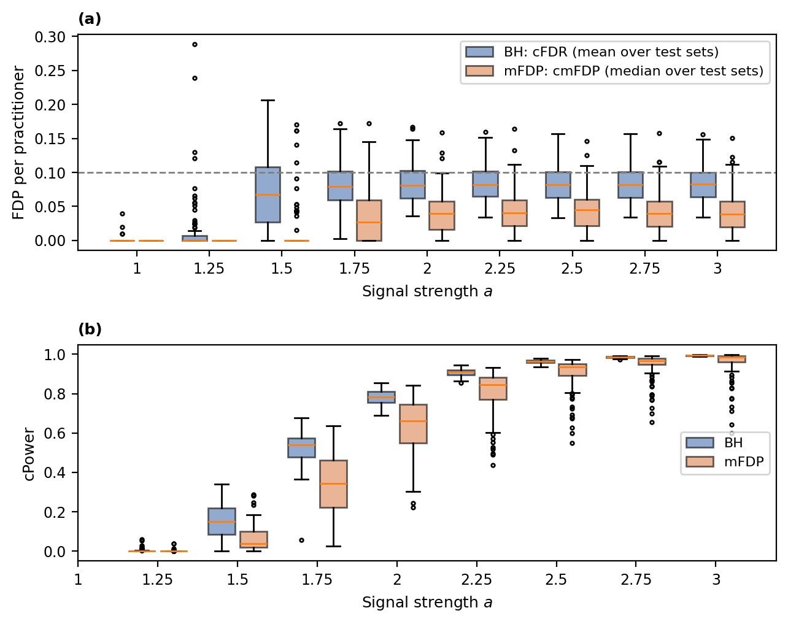
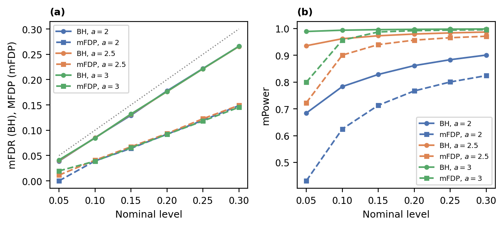
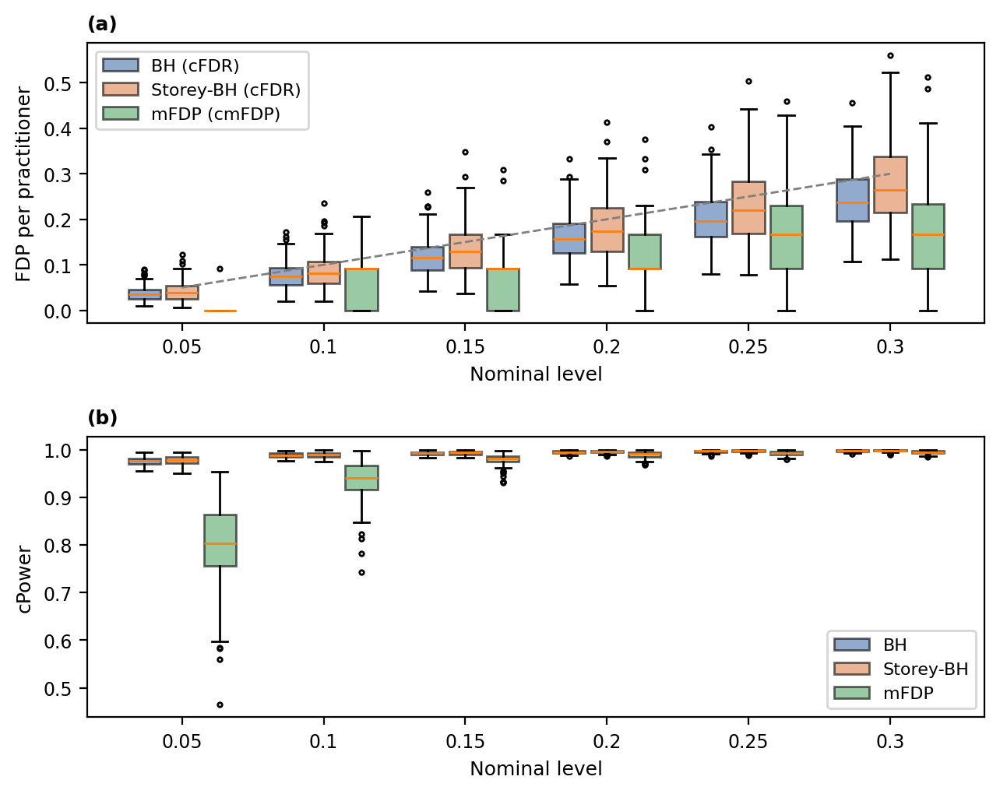
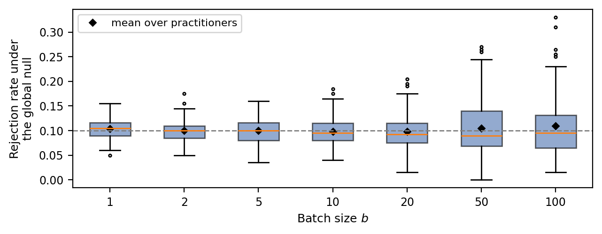

# mFDP-Conformal: median-FDP control for conformal outlier detection

Code for the paper *Median false discovery proportion control for conformal outlier
detection*. It studies the mFDP procedure of Hemerik, Solari and Goeman (2024), which
controls the **median** of the false discovery proportion, applied to the conformal
p-values of Bates, Candès, Lei, Romano and Sesia (2023, *Annals of Statistics*).

The paper proves that mFDP (Algorithm 1 of Hemerik et al.) controls the median FDP when
applied to conformal p-values, even though conformal p-values are dependent and are not
symmetric about one half. This repository reproduces the simulation study: the outlier
detection experiment of Bates et al. (Section 5.2), comparing BH and mFDP, and its batch
version (Section 5.2.3).

## Results

All results use the setting of Bates et al. (2023, Section 5.2): a 50-dimensional
Gaussian mixture, a one-class SVM score, calibration and test sets of 1000 points with 10%
outliers, and J = 100 practitioners (independent calibration sets) with L = 100 test sets
each. BH is summarised by the mean FDP over a practitioner's test sets (cFDR), mFDP by the
median (cmFDP); power is averaged for both.

### Individual outlier detection



*(a) The FDP of each practitioner at level 0.1: cFDR for BH, cmFDP for mFDP. (b) The power
of each practitioner. Boxes show the spread across the 100 practitioners.*

- **BH reproduces Bates et al.** The marginal FDR is about 0.085 at level 0.1, and power is
  0.15, 0.52, 0.78 and 0.96 at signal strengths 1.5, 1.75, 2 and 2.5. Between 25% and 29% of
  practitioners have a conditional FDR above the level.
- **mFDP's median guarantee holds comfortably.** In every configuration at least 84% of test
  sets have FDP at most the level (the guarantee requires 50%). At level 0.1 the median FDP
  over all test sets is about 0.04.
- **The cost is power at moderate signal.** At level 0.1 and signal strength 2, mFDP's power is
  0.63 against 0.78 for BH; the gap narrows as the signal or the level increases.



*(a) Marginal FDR of BH (solid) and marginal median FDP of mFDP (dashed) against the
nominal level; the dotted line is the identity. (b) Power. Signal strengths 2, 2.5 and 3.*

### Batch outlier detection



*Each test set is split into 100 batches of 10 points; 10% of batches contain outliers.
The p-values in each batch are combined with Fisher's method, then BH, Storey-BH and mFDP
are applied across batches.*

At level 0.1, BH and Storey-BH detect 98.8% of contaminated batches and mFDP 93.4%; mFDP's
median guarantee holds empirically, although the theorem does not cover combined p-values.



*Fisher's test on batches of inliers, at level 0.1. Its rejection rate stays near the level
on average (diamonds), but varies increasingly across calibration sets as batches grow.*

## Repository layout

```
run.py              individual detection, BH or mFDP
run_batch.py        batch detection, BH, Storey-BH and mFDP
analyse.py          figures and tables for the paper, from finished runs
requirements.txt
conformal_outliers/
  config.py         all settings, with the paper's defaults
  dgp.py            the Gaussian mixture data model
  calibration.py    marginal p-values (and, optionally, the conditional corrections)
  scoring.py        one-class SVM score
  inference.py      conformal p-values, BH, mFDP, critical values
  experiment.py     individual detection
  batch.py          batch detection and the global-null experiment
  summarise.py      cFDR, mFDR, cmFDP, MFDP, power summaries
  plots.py, io.py   per-run plots and saving
tests/
  test_inference.py property checks of all ported functions
docs/figures/       the figures shown above
```

## Install and run

```sh
pip install -r requirements.txt
```

The paper uses **three runs** and one analysis step:

```sh
python run.py --adjust BH   --outdir results/bh       # 1. individual detection, BH
python run.py --adjust mFDP --outdir results/mfdp     # 2. individual detection, mFDP
python run_batch.py         --outdir results/batch    # 3. batch detection
python analyse.py --bh results/bh --mfdp results/mfdp --batch results/batch
```

Add `--n-jobs 4` to the `run.py` commands to use several cores. For a quick
check first, add `--J 5 --L 5` (and a different `--outdir`).

Defaults (in `conformal_outliers/config.py`) follow Bates et al. (2023),
Section 5.2: J = L = 100, signal strengths 1 to 3 by 0.25, n_cal = n_test = 1000,
10% outliers, one-class SVM with the authors' settings. **Only marginal conformal
p-values are used**; pass `--conditional` to also run the calibration-conditional
corrections. All nominal levels in `alpha_grid` (0.05 to 0.3) are evaluated in
the same run; the main figures use `main_alpha = 0.1`. mFDP's window of
thresholds is fixed at [0, 0.1] (`mfdp_s2`), Hemerik et al.'s default.

## What is saved, and the summaries

Every run saves **every test set's FDP and power**, so all summaries are
computed afterwards from one run. Writing FDP_jl for practitioner j's FDP on
test set l:

| Quantity | Definition | Used for |
|---|---|---|
| cFDR_j | mean of FDP_jl over the L test sets | BH, Storey-BH (Bates et al.) |
| mFDR | mean of all J x L FDPs (= mean of cFDR_j) | BH's guarantee: mFDR <= alpha |
| cmFDP_j | median of FDP_jl over the L test sets | mFDP |
| MFDP | median of all J x L FDPs, pooled | mFDP's guarantee: MFDP <= gamma |
| share_FDP_le_alpha | fraction of all J x L test sets with FDP <= level | mFDP: should be >= 1/2 |
| cPower_j, mPower | mean power over L, then over J | every procedure |

Naming: in Bates et al. the "m" of mFDR means *marginal*; in Hemerik et al. the
"m" of mFDP means *median*. MFDP is the marginal median FDP, which is not the
mean or median of the cmFDP_j.

Files in each `run.py` output folder:

```
per_testset.csv       one row per (method, a, level, practitioner, test set)
per_practitioner.csv  cFDR, cmFDP, cPower, cmPower per practitioner
summary.csv           mFDR, MFDP, share_FDP_le_alpha, mPower, quantiles, ...
results.pkl           all of the above plus the full settings and versions
fdp.png, power.png    quick plots at the main level
pvalues/              per-point p-values for practitioner 1 (see below)
```

`run_batch.py` writes the same tables with a `batch_` prefix, plus
`batch_fwer_global_null.csv` and the batch plots. `analyse.py` writes
`fig_fdp.png`, `fig_power.png`, `fig_levels.png`, `table_section3.csv`,
`table_section4.csv` and `table_section4_fwer.csv` to `results/paper/`.

`pvalues/practitioner_01.csv` has, for each test point, the p-value (`p_`),
the adjusted p-value (`adj_`), whether it was rejected at the main level
(`rej_`), its critical value at its rank (`crit_`), and the final cutoff of its
test set (`cutoff_`).

Tests: `PYTHONPATH=. python tests/test_inference.py`.

## What was ported, and how it was checked

Two R functions had no Python equivalent and were translated by hand from source:

**`p.adjust(p, "BH")`** → `bh_adjust`. Verified against the definition
`padj_(i) = min_{k>=i} (n/k) p_(k)`, capped at 1, computed independently by brute
force.

**`mFDP::mFDP.adjust`** → `mfdp_adjust`. A line-by-line translation of Jesse
Hemerik's R source (CRAN package mFDP, GPL-3), including `kappa.max`, the step-down
loop, and the `Inf` returns that are to be read as 1. This is a translation, not new
work; the package is GPL-3, so this port is too.

Everything else (the mixture model, the three conditional bands, the conformal
p-values) was already a port of the authors' `utils_calib.py`, so it is a
translation of a translation — which is why the band comparison in
`tests/compare_with_r.py` matters.

`tests/test_inference.py` checks the properties each function must satisfy:
monotonicity, permutation equivariance, the location of `Inf` entries, band length
and monotonicity, marginal dominance, and the granularity floor. All pass.

`tests/compare_with_r.py` is the real validation: it takes CSVs dumped from R and
compares to `1e-12`. **Run it before trusting the port for anything you publish.**
The instructions for producing those CSVs are in the script's docstring.

## Deliberate differences from the R version

**Random numbers will not match, ever.** R's Mersenne–Twister and NumPy's PCG64 are
different generators, so the same seed gives different draws. Results are
statistically equivalent, not identical. Everything that does *not* depend on the RNG
— the bands, both adjustment functions, the p-value transform — should match R
exactly, and `compare_with_r.py` is how you confirm that.

**Each practitioner gets its own stream**, seeded `[seed, j]`. Results therefore
don't depend on how many practitioners ran before, and `--n-jobs` parallelism is
safe. The R version used L'Ecuyer-CMRG for the same reason but seeded once.

**SVM kernel width is computed explicitly** as `1 / (d * var(X, ddof=1))` rather than
passing `gamma="scale"`. sklearn's `"scale"` uses the population variance
(`ddof=0`), while R's `var` uses `ddof=1`; passing the string would give a slightly
different kernel.

**`saveRDS` became pickle.** `results.pkl` holds the same payload the R version
put in `all_results.rds`, plus version info.

## The four calibrations (only with `--conditional`)

| Name | What it does |
| --- | --- |
| `Marginal` | plain conformal p-values, valid on average over calibration sets |
| `Conditional (Simes)` | Simes-type simultaneous band |
| `Conditional (Asymptotic)` | normal-approximation band |
| `Conditional (Monte Carlo)` | hybrid band with a simulated finite-sample correction |

The bands depend only on `(n_cal, delta, k)` and never on the data, so `build_bands`
runs once and each correction is a table lookup thereafter. The Monte Carlo band's
binary search is cached in `results/cache/` keyed on `(delta, n_cal, n_mc)`; delete
that directory to force a recompute.

## Notes

- The granularity floor is `1 / (n_cal + 1) ≈ 0.000999` for marginal p-values. The
  conditional corrections raise it: at the default settings the smallest attainable
  values are about 0.0046 (Simes), 0.0040 (asymptotic) and 0.0042 (Monte Carlo). That
  gap is the mechanism behind zero rejections under mFDP.
- `mfdp_adjust` returns `np.inf` for p-values above `s2`. Interpret as 1; `padj <=
  alpha` handles it. When `kappa_max` is infinite the envelope bound is zero false
  positives and adjusted p-values come out at 0 — faithful to the R original, but
  worth knowing before it surprises you.
- Stable sorts are used throughout. Conformal p-values are heavily tied (every value
  is a multiple of `1/(n_cal+1)`), and R's `order()` is stable for numerics, so an
  unstable `argsort` would permute tied entries differently and change which
  hypotheses get flagged.
- `c` in mFDP enters both the numerator and `kappa_max`, so `"1/m"` and `"1/(2m)"` do
  not order pointwise — neither is uniformly looser. What is stable is which entries
  come back infinite, which `s2` alone determines.

## Batch detection details

Each 1000-point test set is split into 100 batches of 10; 10% of batches contain
outliers (half their points, at a = 1.75). The 10 p-values in each batch are
combined with Fisher's method (`--batch-combine fisher_dep` applies Bates et al.'s
equation (6) correction), then BH, Storey-BH (lambda = 0.5, as in the authors'
code) and mFDP are applied across the 100 batch p-values. The global-null
experiment combines batches of pure inliers of increasing size and records how
often Fisher's test rejects at level 0.1.

**Monte Carlo constant.** The binary search for the Monte Carlo band's constant gamma
is dominated by Monte Carlo noise: across seeds at n_mc = 10,000 it lands anywhere
from about 0.07 to 0.1 (the same search as in the authors' code). Monte Carlo results,
especially under mFDP, can therefore depend on the seed; the value used is cached in
`results/cache/` and saved with the results.
